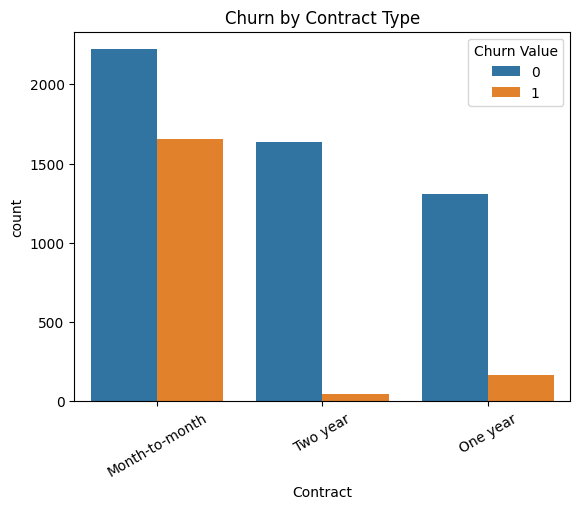
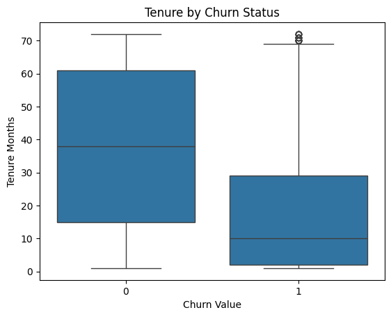

# Identifying and Reducing Telco Customer Churn

**Which customers are about to cancel, and what can a telecom company do about it?** This project builds classification models on IBM's Telco Customer Churn dataset to flag at-risk customers and turns the results into concrete retention recommendations.

📓 [Notebook](telco_churn_model.ipynb) · 📄 [Paper](telco_churn_paper.pdf) · 📊 [Presentation](telco_churn_presentation.pdf)

---

## Key Findings

- **Contract type is the strongest churn signal.** About 43% of month-to-month customers churned, compared with roughly 11% on one-year and 3% on two-year contracts.
- **New customers are the most likely to leave.** Churners had a median tenure of about 10 months, versus about 38 months for customers who stayed.
- **Tree-based models clearly outperformed logistic regression.** Random Forest had the best overall ability to separate churners from non-churners (ROC-AUC 0.84), while a balanced Decision Tree caught the most churners (82% recall).
- **Recall was prioritized over accuracy.** Missing a churner costs a customer's revenue, while flagging a loyal customer only costs a retention offer, so the models were judged mainly on how many churners they caught.

| Model | Recall (churners) | Precision (churners) | ROC-AUC | Accuracy |
|-------|-------------------|----------------------|---------|----------|
| Logistic Regression | 0.41 | 0.44 | 0.70 | 0.70 |
| Logistic Regression (balanced) | 0.48 | 0.44 | 0.71 | 0.70 |
| Decision Tree (balanced, depth 5) | **0.82** | 0.48 | 0.83 | 0.72 |
| Random Forest (balanced) | 0.51 | **0.65** | **0.84** | **0.80** |

*Month-to-month customers churn far more often than customers on one- or two-year contracts (1 = churned).*

## Business Recommendations

1. **Target month-to-month customers in their first year** with offers to move to longer contracts.
2. **Prioritize high monthly-charge customers** in retention campaigns, since they carry the most revenue at risk.
3. **Use the Random Forest as a risk-ranking tool** rather than a strict yes/no classifier, so outreach goes to the highest-risk customers first.
4. **Set the decision threshold based on cost tolerance**, trading extra outreach for more churners caught.

*Illustration: if an average customer is worth $1,200 a year, retaining just 10% of the 275 churners the Random Forest missed would preserve roughly $33,000 in annual revenue.*

## Data

- **Source:** [IBM Telco Customer Churn, Kaggle](https://www.kaggle.com/datasets/ylchang/telco-customer-churn-1113) (a fictional company created by IBM for teaching)
- **Size:** 7,043 customers, 33 columns covering demographics, location, services, contract, billing, and churn status
- **Target:** Whether the customer left in the last quarter (about 26.5% did)
- **Leakage prevention:** Churn Score, CLTV, and Churn Reason were removed because they are only known after churn or derived from it.

## Approach

1. **Cleaning:** Encoded the churn label as binary, dropped ID and leakage columns, converted Total Charges to numeric, and removed the few rows with missing values.
2. **Exploratory analysis:** Churn distribution, churn by contract type, tenure and monthly charges by churn status, and a correlation heatmap.
3. **Preparation:** One-hot encoded categorical variables, made a stratified 70/30 train-test split, and standardized features for logistic regression.
4. **Modeling:** Logistic regression baseline, logistic regression with balanced class weights, a depth-limited decision tree, and a 200-tree Random Forest, with the tree models using balanced class weights to address the 26.5% churn rate.
5. **Evaluation:** Recall and precision for churners, ROC-AUC, and accuracy, plus feature importance to identify the main churn drivers.

## Ethical Considerations

The dataset includes demographic attributes such as gender and senior-citizen status, so a deployed model could treat some groups unfairly. Recommended safeguards include regular bias audits comparing error rates across groups, limiting sensitive attributes in decision rules, and keeping human judgment in final retention decisions.

## Next Steps

- Tune the Random Forest's decision threshold to raise recall while keeping precision acceptable
- Drop location columns (city, zip code, coordinates) before encoding, which should help logistic regression in particular
- Try gradient-boosting models (XGBoost, LightGBM) and tune hyperparameters with cross-validation
- Run a fairness audit across demographic groups

## Tools

Python · pandas · NumPy · scikit-learn · matplotlib · seaborn · Jupyter

---

*Completed March 2026 as a term project for DSC 630 (Predictive Analytics).*
